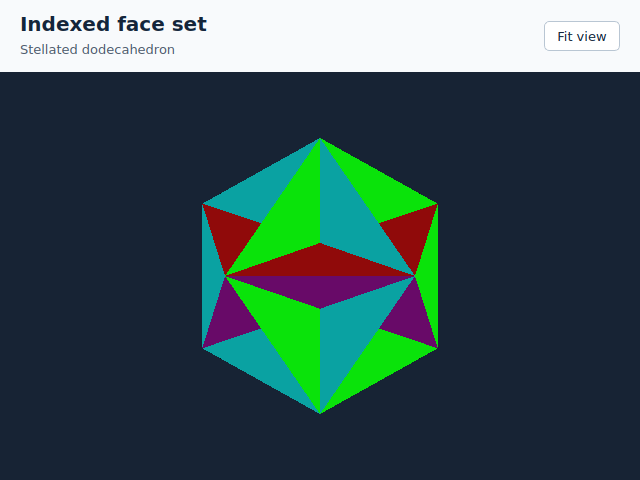

# Classic Coin example captures

These PNGs show five classic scenes in a Qt 6 window using QuarterWidget. Each image captures the 640 × 480 application area at 1× scale, including the scene title and the viewer. The indexed mesh and the Toolmaker node classes are built from [ivexamples](https://github.com/coin3d/ivexamples). The other three scenes use the same geometry and transforms as the book examples with a Quarter camera and headlight. PickAction reports the picked node and path length in the window.

| Example | What to look for |
| --- | --- |
| [HelloCone](images/hello-cone.png) | A red cone built from a material node and a shape node. |
| [TransformOrdering](images/transform-ordering.png) | The same temple geometry appears upright on the left and flattened on the right because the transforms are applied in a different order. |
| [IndexedFaceSet](images/indexed-face-set.png) | A stellated dodecahedron with colors assigned per face. |
| [PickAction initial view](images/pick-action.png) and [after picking](images/pick-action-selected.png) | A ray at the marked position hits the red star. The header shows the node type and the length of the path through the scene graph. |
| [Toolmaker custom nodes](images/toolmaker-nodes.png) | The `Alternate` node skips every other child. The two visible pyramids use custom geometry, materials and transparency. |



## Build the capture viewer

Use Linux with a C++17 compiler, CMake, OpenGL development libraries, Qt 6 Widgets and OpenGL Widgets, Xvfb with `xauth`, and DejaVu Sans. The reference images were captured with Qt 6.4.2, Quarter 1.2.3 and Coin 4.0.10. The Coin revision was [`f73b679140b`](https://github.com/coin3d/coin/commit/f73b679140b9d72a8c726d45c97f295d532fbf98). Keep the Qt, font and Mesa versions fixed when comparing pixels between captures.

From the Coin repository root, build and install Coin. If you already have Coin and Quarter built with Qt 6, set `prefix` to their install prefix and start with the `ivexamples` checkout.

```sh
work_dir="$(mktemp -d)"
prefix="$work_dir/install"

cmake -S . -B "$work_dir/coin-build" \
  -DCMAKE_BUILD_TYPE=Release -DCMAKE_INSTALL_PREFIX="$prefix" \
  -DCOIN_BUILD_TESTS=OFF
cmake --build "$work_dir/coin-build" --target install --parallel

git clone https://github.com/coin3d/quarter.git "$work_dir/quarter"
git -C "$work_dir/quarter" checkout e57b54a05401afc900c907fa06c3eb07c469ef94
git -C "$work_dir/quarter" submodule update --init --recursive
cmake -S "$work_dir/quarter" -B "$work_dir/quarter-build" \
  -DCMAKE_BUILD_TYPE=Release -DCMAKE_INSTALL_PREFIX="$prefix" \
  -DCMAKE_PREFIX_PATH="$prefix" -DQUARTER_USE_QT6=ON
cmake --build "$work_dir/quarter-build" --target install --parallel

git clone https://github.com/coin3d/ivexamples.git "$work_dir/ivexamples"
git -C "$work_dir/ivexamples" checkout 34ecfe34757ae0d5bd5759ba6735e9f041e164be
cmake -S examples/qt6-capture -B "$work_dir/capture-build" \
  -DCMAKE_BUILD_TYPE=Release -DCMAKE_PREFIX_PATH="$prefix" \
  -DIVEXAMPLES_DIR="$work_dir/ivexamples"
cmake --build "$work_dir/capture-build" --parallel
```

If Coin and Quarter are installed in different locations, pass their two prefixes to CMake as a semicolon-separated list.

## Capture the windows

Run this in the same shell as the build. Xvfb provides a fixed screen and Mesa renders in software. The viewer saves each window as a PNG after a rendered frame.

```sh
capture="$work_dir/capture-build/coin-example-capture"
sources="$work_dir/ivexamples"
output="$work_dir/captures"
mkdir -p "$output"

LIBGL_ALWAYS_SOFTWARE=1 QT_SCALE_FACTOR=1 QT_QPA_PLATFORM=xcb \
  xvfb-run -a -s "-screen 0 1280x800x24 -noreset" sh -eu -c '
    capture=$1
    sources=$2
    output=$3
    for example in hello-cone transform-ordering indexed-face-set pick-action toolmaker-nodes; do
      "$capture" "$example" "$sources" --output "$output/$example.png"
    done
    "$capture" pick-action "$sources" --pick 390,276 --output "$output/pick-action-selected.png"
  ' capture "$capture" "$sources" "$output"
```

The pick coordinates are relative to the top-left of the viewport, below the header. For an interactive check on a desktop session, run `"$capture" pick-action "$sources"` and click a star.

The historical GLX, GLUT and Qt 3 programs illustrate their original windowing integrations. The gallery covers the classic scenes that can be hosted in Quarter.

## Regenerate the API reference images

Run the following from the Coin repository root after building the viewer above. The script regenerates 33 of the 35 images in the API reference. It reads Inventor scene blocks and the documented mesh coordinates from the Coin source, loads the default dragger nodes, and runs the projector example that prints an Inventor scene. The viewer saves only the rendered scene. The Text3 capture uses perspective to make the extrusion visible, and the NURBS surface and profile use cameras aligned with the historical views.

The directional light, volume texture and transparency screenshots use scenes defined in [the capture script](capture-api.py). The text captures on Linux were generated with Fontconfig resolving Arial to Liberation Sans.

The original [Centerball interaction](../../docs/doxygen/images/centerballdragger_actionexample.png) and [Jack clip-plane](../../docs/doxygen/images/jack-in-action.png) images document the selected handle and a cut contour on the aircraft model, respectively. Keep those two files with the regenerated figures.

```sh
LIBGL_ALWAYS_SOFTWARE=1 QT_SCALE_FACTOR=1 QT_QPA_PLATFORM=xcb \
  xvfb-run -a -s "-screen 0 1280x800x24 -noreset" \
  python3 examples/qt6-capture/capture-api.py "$capture" "$work_dir/api-images"
```

Review the PNGs and copy them to [the Doxygen image directory](../../docs/doxygen/images/), where the class pages refer to them by filename. Check the images in both [Doxygen builds](../../docs/legacy/doxygen.md), including pages that share the same dragger image.
